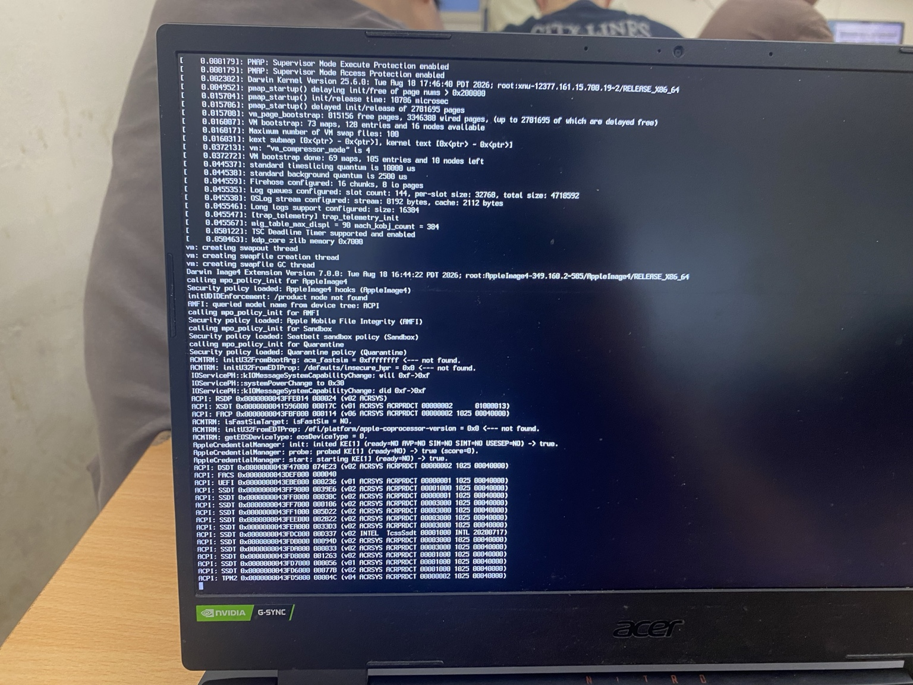

# C1 hardware result — 3 November 2026

[English README](../README.md) · [Tiếng Việt](../README.vi.md)

## Result

**XNU execution and verbose output on the Acer internal display are confirmed by the supplied hardware photograph. Recovery is not reached.** The owner reports that the display remains at the photographed ACPI table listing and does not advance. Observation duration, HDMI state and whether both runs stopped at the same visible line were not recorded. No panic is visible in the photograph.

The screen shows `Darwin Kernel Version 25.6.0`, `VM bootstrap done`, security-policy initialization and ACPI table enumeration. The last visible table is `ACPI: TPM2`. This is the last observed output, **not evidence that TPM caused the stop**. It also does not establish that every CPU or injected kext completed initialization.



## Controlled change and deployment

C0 uses upstream OpenCore 1.0.8 DEBUG with no D1/D2/D3 instrumentation. C1 was copied from the intact C0 package. Its only plist difference is:

```diff
 Kernel/Quirks/ProvideCurrentCpuInfo
- true
+ false
```

CPUID spoof, Kernel/Patch, all nine enabled Kernel/Add entries (including CpuTscSync and CpuTopologyRebuild), ACPI, SMBIOS, boot arguments and Booter quirks were retained. Of 32 EFI files, 31 are byte-identical and only config.plist differs. Both configurations passed ocvalidate 1.0.8. The executable matches the official 1.0.8 DEBUG archive; no diagnostic gate/trampoline is included.

Kingston SA400S37120G 120 GB was identified through the disk, partition and USB device information before writing. The existing EFI and boot directories plus OpenCore logs were backed up locally and hash-verified. C1 was added under `EFI/AcerBootC1/`; the C0 directory and all pre-existing EFI files were preserved. The previous GRUB file remains an exact byte prefix of the updated file. Only this entry was appended:

```grub
if [ "$grub_platform" = "efi" ]; then
menuentry 'Acer Boot C1 - ProvideCurrentCpuInfo OFF' {
    insmod part_gpt
    insmod fat
    insmod chain
    chainloader /EFI/AcerBootC1/OpenCore.efi
}
fi
```

All 32 deployed C1 hashes were verified and ocvalidate was rerun against the USB config. Post-test checking again confirmed all 32 C1 files and all 32 C0 files match their packages; C1 remains False and C0 remains True. No BIOS, NVRAM, partition or OS-data change was made by the deployment. Full EFI/config packages remain local because they retain machine identity fields.

## Log and photo correlation

Two new logs were collected: `opencore-2026-11-03-140857.txt` and `opencore-2026-11-03-141124.txt`. These are firmware log timestamps, without an independently established timezone. Both identify `\EFI\AcerBootC1/OpenCore.efi`, Darwin 25.6.0, successful CPUID patching and nine successful prelinked injections; neither contains `[FAIL]`. Injection success alone does not prove a kext's runtime callbacks executed.

Both logs still end at `EXITBS:START`. The photograph proves subsequent XNU execution, so this final OpenCore log line cannot be treated as the CPU's stopping point. The photograph cannot yet be assigned uniquely to one of the two runs.

Both C0 and C1 report `MP services ... Cores 24 Threads 2`, followed by `Pkg 1 Cores 12 Threads 16`. C0 logs `Patching MSR 35h to 00100010 - Success`; this message is absent from the C1 runs, consistent with disabling the quirk. The shared 24-core diagnostic value is not proof of 24 physical cores: the reviewed OcCpuLib code derives this field from maximum firmware core-location index plus one.

Reviewed excerpts and source-file hashes are in [evidence](../evidence/c1-20261103/summary.json) and [log excerpts](../evidence/c1-20261103/reviewed-log-excerpts.txt). Raw logs remain archived locally; the public excerpts deliberately omit unrelated machine-identity details.

## Interpretation and next step

The C1 result meets the trial's **XNU-output milestone**, but fails the **Recovery-UI milestone**. It supports investigating ProvideCurrentCpuInfo as relevant to the earlier no-output behavior. It does not isolate a particular internal patch, establish a firmware defect, or prove a CpuTopologyRebuild conflict. A repeated C0→C1 comparison under unchanged conditions would strengthen causality; absence of visible C0 output alone never proved that C0 executed no XNU instructions.

[nullmoth/1401 issue #113](https://github.com/nullmoth/1401/issues/113) reports a similar True/False distinction on a nominally similar Acer. Its hardware/configuration and reported stopping point differ; that report is motivation for the test, not proof of an identical cause. C1 here has not demonstrated reaching CoreAnalyticsHub or graphics initialization successfully.

Keep this exact C1 as the new evidence baseline. Before another configuration change, capture a timed video from boot selection through the stationary screen, including any additional output, reboot and HDMI state. Record observation duration and repeatability. Investigate the later initialization stop from that evidence; do not diagnose the last printed ACPI table as the failure or automatically proceed to C2/D4/D5. Rollback is the existing `Acer C0 STOCK CONTROL` or Ubuntu GRUB entry, without BIOS/NVRAM changes.

## Tiếng Việt

**C1 đã chạy XNU và xuất verbose trên màn internal, nhưng chưa vào Recovery.** Người dùng xác nhận màn hình đứng tại phần liệt kê ACPI trong ảnh và không chạy tiếp. Chưa có thời lượng quan sát, trạng thái HDMI hoặc xác nhận cả hai lần đều dừng cùng dòng. Ảnh không thấy panic; `ACPI: TPM2` chỉ là dòng cuối nhìn thấy, chưa phải nguyên nhân lỗi.

C1 chỉ đổi `ProvideCurrentCpuInfo=True` thành `False` so với C0 stock OpenCore 1.0.8 DEBUG. CPUID, 9 kext, ACPI, SMBIOS, boot-args và mọi quirk khác giữ nguyên. 32 file được đối chiếu hash sau triển khai và sau boot; ocvalidate 1.0.8 đạt. C0, các EFI cũ và Ubuntu được bảo toàn; GRUB chỉ thêm entry riêng cho C1. EFI/boot/log cũ đã được sao lưu cục bộ trước khi ghi.

Hai log mới đều nhận đúng C1 và vẫn kết thúc tại EXITBS. Tuy nhiên ảnh có Darwin 25.6.0, VM bootstrap, security policies và ACPI, nên lần này đã có bằng chứng XNU thực thi sau handoff. Chưa xác định ảnh thuộc log nào. Không đồng nhất việc inject kext thành công với kext đã khởi tạo đầy đủ.

Đạt mục tiêu xuất hiện đầu ra XNU; chưa đạt mục tiêu Recovery. Kết quả hỗ trợ giả thuyết quirk liên quan đến biểu hiện trước đó, nhưng chưa chứng minh BIOS lỗi hay xung đột topology cụ thể. Giữ C1 làm mốc, ghi video/thời lượng dừng và kiểm tra khả năng lặp lại trước khi thay biến khác. Chưa triển khai C2 hoặc tiếp tục D4/D5.
